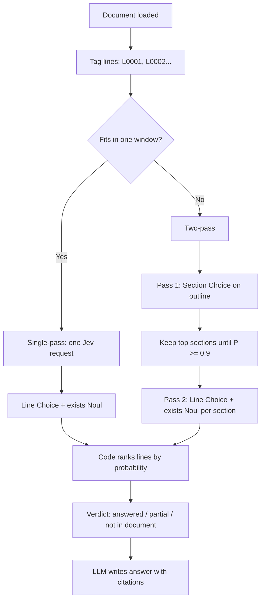

# Ctrl+F for Meaning

**Long-document search with no vector database.** Load a document (terms of service, lease, handbook, PDF) and ask a plain-language question. [Jev](https://typesafe.ai) (TypeSafe AI's fast decision model) points to the exact lines that answer it and says whether the document answers it at all. An LLM writes a short answer with line citations. A toggle runs an OpenAI embeddings baseline alongside for comparison.

**Jev finds, code ranks, the LLM writes.**

## Why Vectorless?

| Feature | Vectorless (Jev) | Embeddings |
|---|---|---|
| No index to build | Yes | No (must embed every line) |
| Line-level citations | Exact line IDs | Nearest-neighbor chunks |
| "Not in this document" signal | Yes (exists Noul) | No (always returns nearest) |
| Cold-start cost | One API call | Embed all lines first |

## How It Works



### Single-pass flow

When the document fits in one window (≤250 lines, ~14k tokens, under the 60k-character state limit), Jev gets one request with two questions:
- **where** (Choice): which line ID contains the answer? Each line is an option with `null` criteria.
- **exists** (Noul): does any line address this question?

### Two-pass flow

For longer documents:
1. **Section pass**: Jev gets the section outline and selects which sections are likely to contain the answer (sent as a `where` Choice over section IDs). Code keeps top sections until cumulative probability reaches 0.9 (max 3), skipping `none`.
2. **Line pass**: Jev runs `where` + `exists` on each kept section. Code combines: `relevance = p(section) × p(line)`, `exists = max` over windows.

### Verdict policy

`exists ≥ 0.7` → **answered**. `exists < 0.35` → **not in this document**. Between → **partially addressed**. Thresholds are in code, not the model.

## Setup

```bash
# Install dependencies
npm install

# Set secrets (server-side only, never in browser)
supabase secrets set TYPESAFE_API_KEY=your_typesafe_key
supabase secrets set OPENAI_API_KEY=your_openai_key
# Optional overrides:
supabase secrets set OPENAI_BASE_URL=https://api.openai.com/v1
supabase secrets set OPENAI_MODEL=gpt-4o-mini
supabase secrets set OPENAI_EMBED_MODEL=text-embedding-3-small

# Deploy edge functions
# (done automatically via the Supabase MCP deploy tool)

# Run the dev server
npm run dev
```

### Environment Variables

| Variable | Where | Required | Default | Description |
|---|---|---|---|---|
| `VITE_SUPABASE_URL` | `.env` (client) | Yes | — | Supabase project URL |
| `VITE_SUPABASE_ANON_KEY` | `.env` (client) | Yes | — | Supabase anon key |
| `TYPESAFE_API_KEY` | Supabase secret | For Jev | — | TypeSafe AI API key |
| `OPENAI_API_KEY` | Supabase secret | For LLM + embeddings | — | OpenAI API key |
| `OPENAI_BASE_URL` | Supabase secret | No | `https://api.openai.com/v1` | OpenAI-compatible base URL |
| `OPENAI_MODEL` | Supabase secret | No | `gpt-4o-mini` | LLM model for answer writer |
| `OPENAI_EMBED_MODEL` | Supabase secret | No | `text-embedding-3-small` | Embedding model for baseline |

## Offline Mode

The app works with no API keys and no network:
- **Recorded responses** (`src/fixtures/recorded.ts`) replay real Jev + embeddings response shapes for preset queries. An "Offline replay" toggle serves them with a "Replayed" badge.
- **Custom queries offline** use a BM25 ranker (Jev slot) and TF-IDF cosine (baseline slot), labeled "Fallback (not Jev)". Never presented as real Jev results.

## Sample Documents

1. **Acme Cloud Terms of Service** — ~40 lines, single-pass. Content ownership, account suspension, age requirements, no arbitration.
2. **Northwind Employee Handbook** — ~30 lines, single-pass. PTO, remote work, expenses, conduct.
3. **Maple Street Residential Lease** — ~70 sections, two-pass. Rent, deposits, pets, maintenance, termination.

## Architecture

- **Frontend**: Vite + React + TypeScript + Tailwind CSS
- **Backend**: Supabase (Postgres + Edge Functions)
- **AI**: Jev (TypeSafe AI) for search, OpenAI for answer writing and embeddings baseline
- **PDF extraction**: `pdfjs-dist` (in-browser, no server needed)

### Edge Functions

1. **`jev-search`** — Calls Jev. Pins model `jev-1.13.0` server-side and accepts only a string `state` (≤60k chars) plus `where`/`exists` questions; anything else is a 400. Retries 429/529 with exponential backoff.
2. **`answer`** — LLM writer. Takes query, verdict, and top lines with neighbors (size-capped). Answers only from provided lines with `[Lxxxx]` citations.
3. **`embed-search`** — Baseline. Uses only `OPENAI_EMBED_MODEL` (a `model` in the request is ignored), ≤2,000 lines. Calls OpenAI embeddings in batches of 100, computes cosine similarity, returns top 8 lines.
4. **`persist`** — Insert-only writes for `documents` (`save_document`, size-limited, returns the id) and `searches` (`save_search`, the document must exist). No AI calls.

All functions have `verify_jwt = true` and read URLs, keys and models only from env.

### Daily demo cap

Every paid upstream fetch (each Jev attempt including retries, each embeddings request/batch, each LLM call) first calls `increment_usage` (service role only). The cap is 200 calls/day for the whole app. Over the cap the function returns 429 `{"error":"Daily demo limit reached - showing offline results","demo":true}`; if the counter can't be checked it fails closed with 503 and the same body. The browser then shows a notice and uses recorded replay / BM25 / extractive answers.

### Database Schema

- `documents` — loaded documents with tagged lines and section outlines
- `searches` — search results for stats and replay
- `line_embeddings` — cached embeddings per document + model
- `usage_counters` — per-day call counts for the demo cap (no client access)

The browser has read-only (SELECT) access to `documents`, `searches` and `line_embeddings`; all writes go through `persist`.

## Design Decisions

- **Query in instructions, stable state**: The document text goes in `state` (never changes between searches); the query goes in `instructions`. This means the same state can be reused across different questions.
- **`null` option criteria**: Since the state already holds each line's text, option criteria are `null` — Jev reads the line text from state.
- **Exists Noul as the abstain signal**: Choice probabilities sum to 1, so some line always ranks first. The `exists` Noul is the real "does the document address this?" signal.
- **255-option and 64k limits drive windowing**: Jev supports max 255 Choice options and 64k context. Documents exceeding these are split into windows or processed via two-pass.
- **Thresholds in code**: The verdict (answered/partial/not in document) is computed in code from the `exists` value, not by the model. This keeps the decision auditable and adjustable.
- **Honest offline fallbacks**: Fallback results are clearly labeled "Fallback (not Jev)" and never presented as real Jev output. Recorded responses show a "Replayed" badge.

## Screenshots

<!-- Add screenshots of the hero, search results, document viewer, and comparison panel here -->


